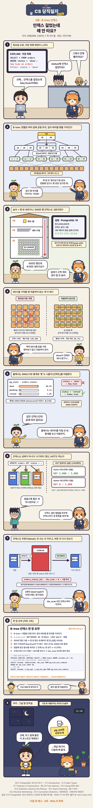

# [CS 당직일지 3화] 인덱스 걸었는데 왜 안 타요?

URL: https://s3onghyun.github.io/posts/cs-comic-03-btree-index/
Markdown: https://s3onghyun.github.io/posts/cs-comic-03-btree-index.md
Published: 2026-11-04
Updated: 2026-11-04

[치즈 선배의 CS 당직일지](/series/cs-comic/) 3화. 태오가 `status`에 인덱스를 만들었는데도 목록 조회는 Seq Scan이다. B-tree가 언제 도움이 되는지, 왜 플래너가 다른 길을 고르는지 따라가 본다.

<figure class="comic"></figure>

## 이번 화에서 배운 것

- B-tree는 정렬된 여러 갈래 트리다. 적은 행을 찾을 때는 인덱스 페이지를 몇 단계 내려가 빠르게 위치를 찾는다.
- 결과가 테이블 대부분이라면 행마다 점프하는 인덱스보다 처음부터 읽는 Seq Scan이 더 쌀 수 있다.
- 플래너는 `ANALYZE` 통계로 선택도를 추정한다. 데이터 분포가 바뀌었다면 통계부터 갱신한다.
- 인덱스는 쓰기 때도 관리 비용이 든다. 쓰지 않는 인덱스와 부푼 인덱스는 점검한다.

## 봄의 당직 노트 p.3

1. `EXPLAIN (ANALYZE, BUFFERS)`로 실제 계획과 행 수 추정을 비교한다.
2. 조건이 적은 행을 고르는지, 정렬이나 범위 조건에 맞는지 확인한다.
3. 데이터가 크게 바뀌었으면 `ANALYZE`를 먼저 한다.
4. `pg_stat_all_indexes.idx_scan`으로 사용량을 살피되, 통계 초기화·복제본 사용 여부도 함께 본다.
5. 운영 중 인덱스를 만들거나 다시 지을 때는 잠금 영향을 검토하고 `CONCURRENTLY` 옵션을 고려한다.

## 일부러 단순하게 그린 부분

- 그림의 500만 행·3층·95% 비율은 한 예제 데이터에서 나온 값이며 모든 테이블에 그대로 적용되지 않는다.
- 비용은 환경 설정과 캐시 상태에 따라 바뀐다. 인덱스를 강제로 쓰게 하기보다 계획과 통계를 먼저 확인한다.

## 출처

- [PostgreSQL: Introduction to Indexes](https://www.postgresql.org/docs/current/indexes-intro.html)
- [PostgreSQL: B-Tree Indexes](https://www.postgresql.org/docs/current/btree.html)
- [PostgreSQL: Using EXPLAIN](https://www.postgresql.org/docs/current/using-explain.html)
- [PostgreSQL: Statistics Used by the Planner](https://www.postgresql.org/docs/current/planner-stats.html)

쿠키의 `pg_wal` 메모는 다음 WAL 이야기로 이어진다.

## Related posts

- [[CS 당직일지 2화] DELETE 했는데 왜 디스크가 그대로예요?](https://s3onghyun.github.io/posts/cs-comic-02-mvcc-vacuum/)
- [[CS 당직일지 막간 2] BEGIN 해 놓고 퇴근한 범인](https://s3onghyun.github.io/posts/cs-comic-interlude-02-culprit/)
- [[CS 당직일지 1화] 업그레이드, 왜 1시간 넘게 기다려요?](https://s3onghyun.github.io/posts/cs-comic-01-batched-background-migrations/)
