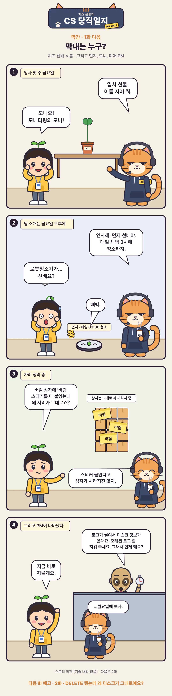

# [CS 당직일지 막간 1] 막내는 누구?

URL: https://s3onghyun.github.io/posts/cs-comic-interlude-01-first-week/
Markdown: https://s3onghyun.github.io/posts/cs-comic-interlude-01-first-week.md
Published: 2026-10-31
Updated: 2026-10-31

[치즈 선배의 CS 당직일지](/series/cs-comic/) 막간 1. 봄의 입사 첫 주, 팀의 막내와 새 화분 모니를 소개한다.

<figure class="comic"></figure>

## 이야기 치트 시트

- **모니**는 모니터링의 모니. 시즌 동안 잎이 한 장씩 늘어난다.
- **먼지 선배**는 매일 새벽 3시에 청소하는 로봇청소기다.
- 다음 화: DELETE 했는데도 디스크가 그대로인 이유.

## Related posts

- [[CS 당직일지 막간 3] 당직실의 3분](https://s3onghyun.github.io/posts/cs-comic-interlude-03-coffee/)
- [[CS 당직일지 막간 2] BEGIN 해 놓고 퇴근한 범인](https://s3onghyun.github.io/posts/cs-comic-interlude-02-culprit/)
- [[CS 당직일지 3화] 인덱스 걸었는데 왜 안 타요?](https://s3onghyun.github.io/posts/cs-comic-03-btree-index/)
