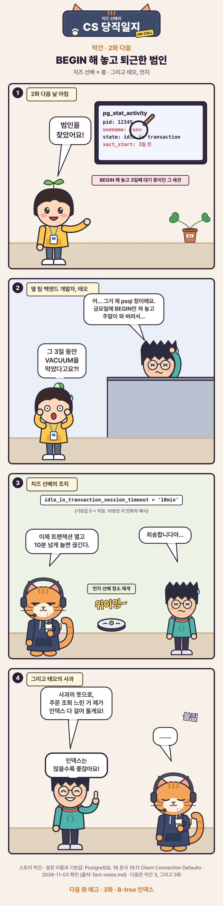

# [CS 당직일지 막간 2] BEGIN 해 놓고 퇴근한 범인

URL: https://s3onghyun.github.io/posts/cs-comic-interlude-02-culprit/
Markdown: https://s3onghyun.github.io/posts/cs-comic-interlude-02-culprit.md
Published: 2026-11-02
Updated: 2026-11-02

[치즈 선배의 CS 당직일지](/series/cs-comic/) 막간 2. 봄이 `pg_stat_activity`에서 오래 열린 트랜잭션의 주인을 찾는다.

<figure class="comic"></figure>

## 이번 막간에서 배운 것

- 열린 트랜잭션은 아직 볼 수 있는 옛 행 때문에 VACUUM이 dead tuple을 치우지 못하게 한다.
- `idle_in_transaction_session_timeout`은 열린 트랜잭션 안에서 오래 유휴 상태인 세션을 종료한다. 값은 서비스 특성에 맞춰 정한다.
- 다음 화: 인덱스는 많을수록 정말 좋을까?

## Related posts

- [[CS 당직일지 3화] 인덱스 걸었는데 왜 안 타요?](https://s3onghyun.github.io/posts/cs-comic-03-btree-index/)
- [[CS 당직일지 막간 3] 당직실의 3분](https://s3onghyun.github.io/posts/cs-comic-interlude-03-coffee/)
- [[CS 당직일지 2화] DELETE 했는데 왜 디스크가 그대로예요?](https://s3onghyun.github.io/posts/cs-comic-02-mvcc-vacuum/)
