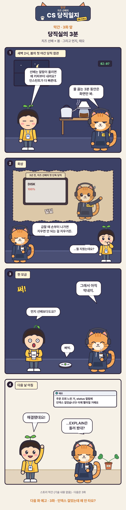

# [CS 당직일지 막간 3] 당직실의 3분

URL: https://s3onghyun.github.io/posts/cs-comic-interlude-03-coffee/
Markdown: https://s3onghyun.github.io/posts/cs-comic-interlude-03-coffee.md
Published: 2026-11-03
Updated: 2026-11-03

[치즈 선배의 CS 당직일지](/series/cs-comic/) 막간 3. 새벽 당직실에서 봄은 치즈 선배가 알람 뒤에 바로 행동하지 않는 이유를 묻는다.

<figure class="comic"></figure>

## 이야기 치트 시트

- 알람이 울렸을 때의 짧은 멈춤은 성급한 조치를 막는 운영 습관이다.
- 치즈 선배의 과거에는 아직 밝혀지지 않은 삭제 사고가 있다.
- 다음 화: 인덱스를 걸었는데도 왜 Seq Scan일까?

## Related posts

- [[CS 당직일지 막간 2] BEGIN 해 놓고 퇴근한 범인](https://s3onghyun.github.io/posts/cs-comic-interlude-02-culprit/)
- [[CS 당직일지 막간 1] 막내는 누구?](https://s3onghyun.github.io/posts/cs-comic-interlude-01-first-week/)
- [[CS 당직일지 3화] 인덱스 걸었는데 왜 안 타요?](https://s3onghyun.github.io/posts/cs-comic-03-btree-index/)
