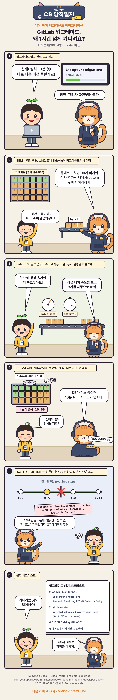

[치즈 선배의 CS 당직일지](/series/cs-comic/) 1화. 설치가 끝났다고 업그레이드가 끝난 것은 아니다. 큰 테이블 변경을 작은 작업으로 나누어 뒤에서 처리하는 **배치 백그라운드 마이그레이션(BBM)**을 따라가 본다.

<figure class="comic"><picture><source srcset="/comics/cs-comic/ep01-webtoon.webp" type="image/webp" /></picture></figure>

## 이번 화에서 배운 것

- 큰 변경을 작은 **batch**로 나눠 백그라운드에서 처리하면 한꺼번에 부하를 주지 않는다.
- batch 크기와 동시 실행 수는 DB 부하를 보며 정하고, DB가 바쁜 신호가 보이면 잠시 멈춘다.
- 다음 단계로 가기 전 진행·보류·실패한 작업이 없는지 확인하고, 그 대기 시간도 계획에 넣는다.

## 운영 치트 시트

- 대기열 길이·처리율·실패 수와 데이터베이스 지표를 함께 본다.
- 종료 조건은 "진행 중인 마이그레이션이 0개"처럼 명확하게 둔다.
- 병렬도를 늘리기 전에 DB 부하가 감당 가능한지 먼저 확인한다.

4컷의 autovacuum 복선은 [2화 MVCC와 VACUUM](/posts/cs-comic-02-mvcc-vacuum/)에서 이어진다.
