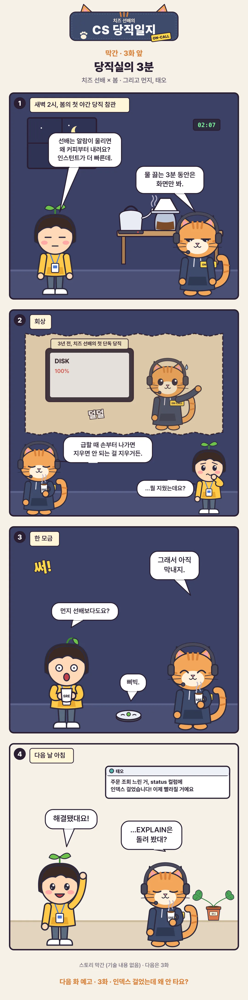

[치즈 선배의 CS 당직일지](/series/cs-comic/) 막간 3. 새벽 당직실에서 봄은 치즈 선배가 알람 뒤에 바로 행동하지 않는 이유를 묻는다.

<figure class="comic"></figure>

## 이야기 치트 시트

- 알람이 울렸을 때의 짧은 멈춤은 성급한 조치를 막는 운영 습관이다.
- 치즈 선배의 과거에는 아직 밝혀지지 않은 삭제 사고가 있다.
- 다음 화: 인덱스를 걸었는데도 왜 Seq Scan일까?
